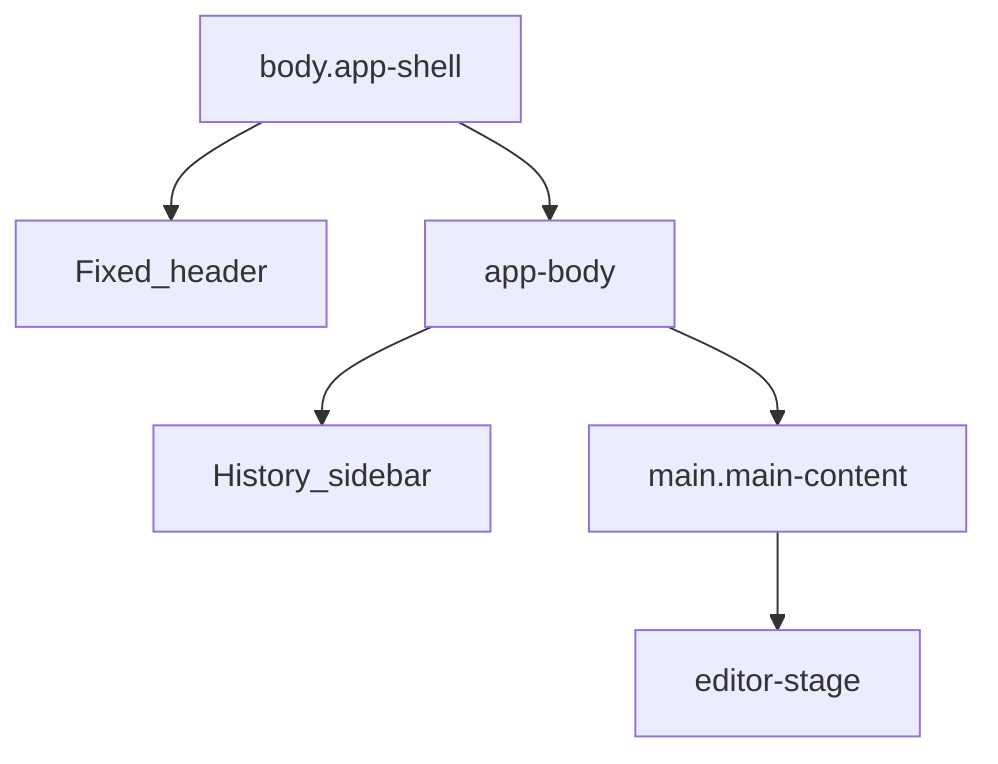
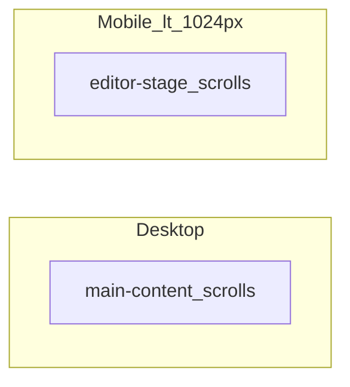

# Editor shell

The editor UI is a fixed app chrome around the A4 page preview. Markup lives in `editor/index.html`; layout tokens and shell CSS are in `editor/css/tokens.css`, `layout-shell.css`, `header-responsive.css`.

## Layout blocks

| Region | Responsibility |
|--------|----------------|
| Header | History toggle, brand, document name, the format toolbar (centre pill, with the dictation mic at its right end), PDF (Hindi Typing toggle on wider screens). On the mobile layout (<1024px) the toolbar leaves the header: it docks flush above the on-screen keyboard and appears only while the user is in the document editor (see below) |
| History sidebar | Top (fixed): one row with the **Diary ▾ / Letter** switcher on the left and the **New diary / New letter** button beside it (it follows the switcher), then a full-width search box. Middle (scrolls): documents grouped by day, each row a name, time and a **…** menu (**Move to Trash**, then **Download Word**). Footer: backup status in words ("Back up to Drive", "Backing up…", "Backed up", "N not backed up", "Backup failed · retry"; opens the sync menu) and **Trash** with a count |
| `main-content` | Desktop vertical scrollport; padding for fixed header |
| `editor-stage` | Page preview; on mobile also the scroll / pinch viewport |

Orchestration: `editor/js/main.js` (sidebar toggle, template switch, autosave hooks, chrome height).

## History behavior

- Opens/closes only via the panel button (or Ctrl/Cmd+H / B) — not by outside click.
- On the desktop layout (≥1024px), opening History nudges the workspace slightly; on smaller screens it is an overlay drawer.
- Documents are grouped by **date created**; older day groups start collapsed. Each row shows last-updated time.
- Each row's **…** button is always visible (never hover-only), so touch and keyboard users can reach it. It opens one shared menu ([`popmenu.js`](../../editor/js/popmenu.js): arrow keys, Esc returns focus, outside press closes). Word export: [Word export](word-export.md).
- A row shows a cloud badge only when it needs attention (pending or failed backup); a fully backed-up list carries none, because the footer already says "Backed up".
- Using the row menu, the Trash dialog or the Undo toast does not collapse the panel, even though they sit outside the `<aside>`.
- The Drive button keeps the same chrome as its neighbours; the sync state is a corner dot (red = not connected / error, blue = syncing, green = connected) plus the button's title and label.
- Drive backup menu (sidebar): **Sync all** (pull + push), **Sync new** (push pending only), **Disconnect**.

## Scroll ownership

- **Desktop:** `.editor-stage` stays `overflow: visible` so wheel events reach `.main-content`.
- **Mobile:** `.main-content` is `overflow: hidden`; `#editorStage` scrolls (and handles pinch).

See: [Desktop vs mobile](../desktop-vs-mobile.md), [Page preview](page-preview.md).

## Phone formatting bar

On the mobile layout (<1024px) the format toolbar is a `position: fixed` bar ([`keyboard-dock.js`](../../editor/js/editor/keyboard-dock.js), styles in `header-responsive.css`):

- **Placement:** `bottom` is the gap between the layout viewport and the `visualViewport` (`keyboardInset`), i.e. the keyboard's height, so the bar sits directly above it on iOS (which pans rather than resizes) and Android alike. It follows `visualViewport` resize/scroll.
- **When it shows:** only after a tap or key press, while the document editor root (`.bp-doc`) or the bar itself has focus. Diary header fields (FIR, date…) live inside that root but are not formattable, so they do not raise it; neither does the programmatic focus on load or for a new document.
- **Keys:** The same look as the desktop pill: white bar, navy icons, transparent 40px buttons and thin group rules, with a rounded top edge. Centred when they fit; the row scrolls sideways when they do not (narrow phones), with an edge shadow showing there is more. Mousedown on the bar is prevented (`toolbar.js`), so a tap never takes focus from the editor.
- On desktop (≥1024px) nothing changes: the pill stays in the header.

## Icons

Icons are local, not a font or CDN. Markup stays `<i class="fas fa-name" aria-hidden="true"></i>`; [`css/icons.css`](../../editor/css/icons.css) draws each name as a Lucide-style SVG (24px grid, 2px stroke) used as a CSS mask over `currentColor`. They follow the text colour and `font-size`, add no network request and work offline. To add one, add a `.fa-<name>` rule there; `js/icons.test.js` fails if the HTML or JS uses a name with no rule. Icons are decorative, so the button carries the `aria-label` / `title`.
