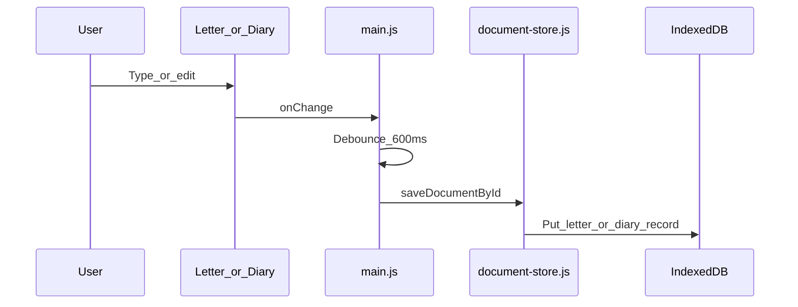

# Local storage (IndexedDB)

Documents autosave on the device that is running the editor. Database name: **`bp-writing-tool`** (`editor/js/document-store.js`).

## Save sequence

## Document fields (conceptually)

| Field | Meaning |
|-------|---------|
| `type` | `letter` or `diary` |
| `filename` | Display name (often a date) |
| `content` | JSON `{ format: "bp-doc", v: 1, doc }` — the editor document (pages, header fields, text). Other shapes are shown as **Older format** in History and can only be deleted. |
| `uuid` | Stable id used for Drive file matching |
| `driveFileId` / `syncedAt` / `syncError` | Backup metadata |
| `trashedAt` | In **Trash**: hidden from History, content kept, never synced. `null` = not trashed |
| `deletedAt` | Soft-delete (tombstone for Drive) |

## Trash

The History row's trash icon moves a document to Trash (`trashDocumentById`) — no confirm; a toast offers **Undo**. Trashing keeps the content and Drive metadata and leaves `updated_at` alone, so the row never looks newer than its Drive copy. Trash lives in a dialog opened from the sidebar footer and lists the **active template's** documents, with search, **Restore** and **Delete forever**.

- Trashed rows are skipped by `needsBackup` / `listPendingSync`: nothing uploads and no Drive copy is touched while a document is in Trash.
- **Delete forever** (`deleteTrashedForever`) is the old delete: a never-backed-up document is removed outright; otherwise it becomes a `deletedAt` tombstone and the Drive copy is removed on the next sync. **Restore** clears `trashedAt` and bumps `updated_at`, so it backs up again.
- `saveDocumentById` throws `DocumentUnavailableError` for a trashed or deleted row, so a late autosave cannot pull a document out of Trash. If that happens to the open document (trashed from another tab), the editor detaches and saves the edits as a new document instead of dropping them.
- A remote edit of a trashed document refreshes its content but keeps it in Trash; a remote tombstone removes it for good.
- Older-format documents cannot be restored, so they skip Trash and use the confirm-then-delete path in [`unsupported-docs.js`](../../editor/js/unsupported-docs.js).
- Trash never expires on its own.

## History search

The sidebar search filters the active template's list as you type. A document matches when every word appears in its filename, diary header fields (except the pre-filled `rule_no`) or body text (`history-search.js`). Matching day groups expand; the user's own expand/collapse state returns when the search is cleared. Esc or × clears it.

History lists live documents for the **active** template only, newest created first. `localStorage` keeps `lastActiveDocId` / `lastActiveDocType` so a reload reopens the same document. Delete soft-deletes when a Drive copy may exist; otherwise hard-delete. Deleting an older-format document also clears its `content` in the tombstone, so no unusable payload stays on the device or in Drive.

Prefs for UI/auth flags use `localStorage` via `prefs.js` (`bpnt.*` keys) — separate from document IndexedDB.

See: [Drive backup](drive-backup.md).
