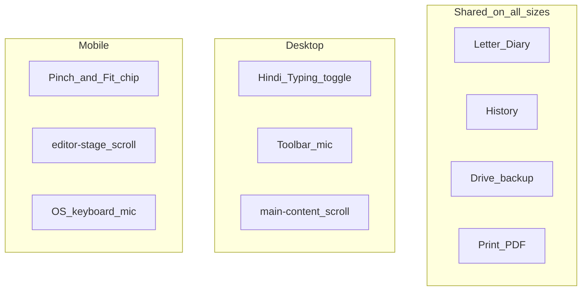

# Desktop vs mobile

There are exactly **two layouts**, split at **1024px**:

- **Desktop** — viewport **≥ 1024px** (laptops and desktops, tablets in landscape).
- **Mobile** — viewport **< 1024px** (phones, and tablets in portrait). There is **no separate tablet layout**.

The boundary lives in one place for scripts, [`editor/js/layout.js`](../editor/js/layout.js) (`MOBILE_QUERY = (max-width: 1023px)`), and is written as `max-width: 1023px` / `min-width: 1024px` in the stylesheets. `layout.test.js` fails if a stylesheet adds any other layout breakpoint. The only other width rules are a 1100px tightening of the narrowest desktop header and 520 / 480 / 420px phone refinements *inside* the mobile layout.

### Header at each size

| | Desktop (≥1024px) | Mobile (<1024px) |
|---|---|---|
| Left | Panel toggle, logo (Hindi wordmark above 1100px), document name | Panel toggle, logo |
| Centre | Formatting pill (with Hindi Typing toggle and mic) | Document name, centred in the gap |
| Right | PDF (text label above 1100px) | PDF, always flush right |
| Formatting toolbar | In the header | Not in the header — docks above the keyboard while an editor has focus |
| Height | 77px | 57px |

## Feature matrix

| Capability | Desktop (≥1024px) | Mobile (<1024px) |
|------------|------------------|----------------|
| Letter & Diary templates | Yes | Yes |
| Document History | Yes (sidebar; slight workspace nudge on very wide screens) | Yes (overlay drawer) |
| Google Drive backup | Yes | Yes |
| Print / Save as PDF | Yes (browser print dialog) | Yes (iOS/iPadOS: raster A4 PDF; others: browser print) |
| Document name in header | Yes | Yes |
| Hindi Typing toggle | Yes | Hidden |
| Transliteration suggestions | Yes (Toggle ON) | Off — type with keyboard / OS tools |
| In-app dictation microphone | Yes (mic at the right end of the toolbar) | Hidden — use keyboard mic |
| Page fit-to-width | Automatic | Automatic + pinch, double-tap, Fit chip |
| Vertical scrolling | `.main-content` | `#editorStage` |
| Help (`?`) | Yes | Yes |

## Why these differences

- **Phones already expose a keyboard microphone** — the in-app mic would duplicate it and crowd the page.
- **Transliteration suggestions need a stable popup UX** — on narrow screens the app relies on the system keyboard instead.
- **Pinch-zoom** is natural on touch; desktop mostly needs fit-to-width.
- **Scrollport split** avoids nested scroll traps (wheel on the page must reach the right container).
- **iOS/iPadOS PDF export** uses a raster A4 PDF from the same print-document cards because WebKit print applies forced margins and a 0.8 shrink that clips diary/letter pages. Desktop keeps native print. See [Templates](components/templates.md).
- **Rasterizer compensations** live in `prepareCloneForRaster()` and apply to the raster PDF path only: every table line is drawn by exactly one cell edge (html2canvas ignores `border-collapse`, so shared edges would print double, and a border on the table itself is partly hidden under the opaque cell backgrounds).
- **Font boosting is disabled** in the print document (`text-size-adjust: 100%`): the document is a fixed 210mm sheet, and WebKit otherwise inflates text in blocks wider than the phone viewport.

## Related code

- The boundary: `editor/js/layout.js` (+ `layout.test.js`)
- Header / lang hide: `editor/css/header-responsive.css`
- Dictation hide: `editor/js/dictation-ui.js`, `editor/css/overlays-responsive.css`
- Translit gate: `isTransliterationEnabled()` in `editor/js/main.js`
- Scale / pinch: `editor/js/page-scale.js`, `editor/css/page-preview.css`
- Shell scroll: `editor/css/layout-shell.css`, `page-preview.css`
- Export routing: `editor/js/export/router.js`, `editor/js/export/raster-pdf.js`, `editor/js/export/print-document.js`

See: [Architecture](architecture.md), [Editor shell](components/editor-shell.md), [Page preview](components/page-preview.md).
